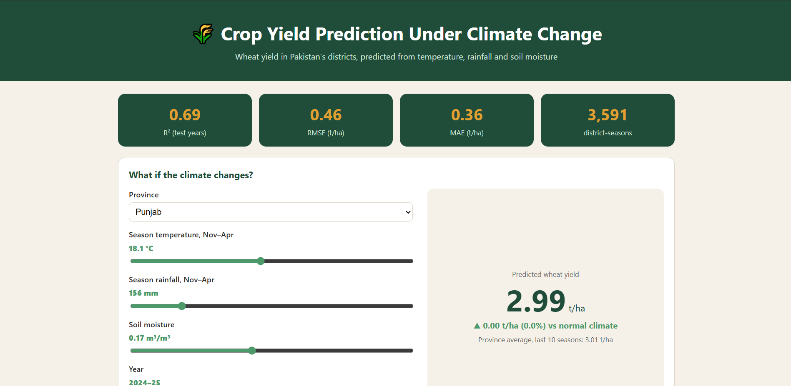
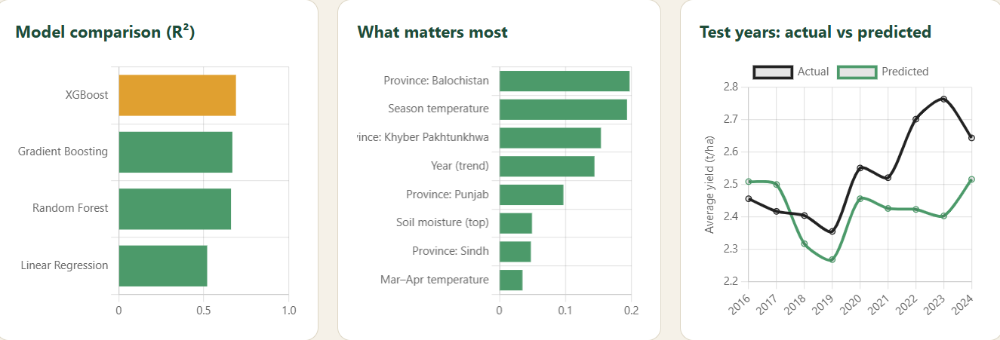
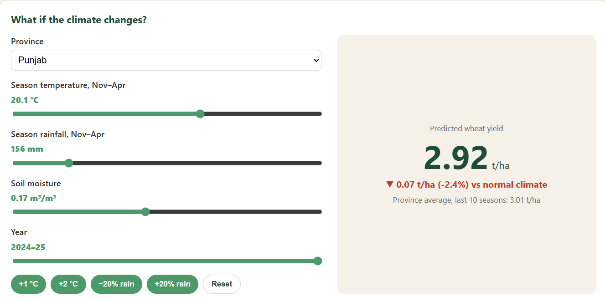
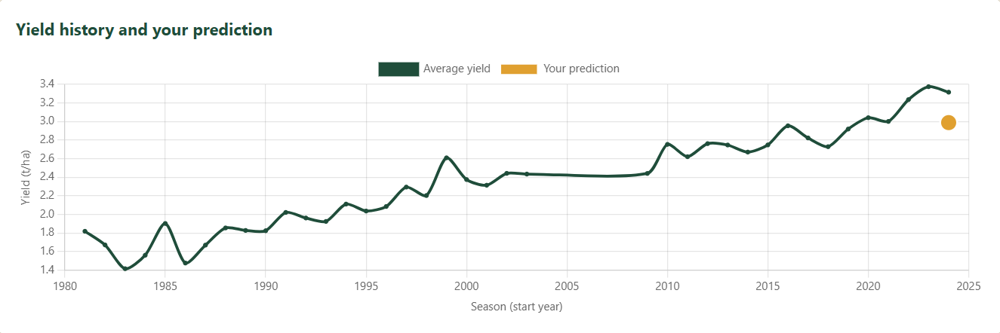

# 🌾 Crop Yield Prediction Under Climate Change

A machine learning project that predicts **district-level wheat yield in Pakistan** from temperature, rainfall and soil moisture, with an interactive web dashboard for exploring "what if the climate changes?" scenarios.

## Why this project?

Climate change is shifting temperature and rainfall patterns, and wheat is sensitive to both. Reliable yield estimates help farmers and decision-makers plan for food security. This project asks: **how well can climate conditions predict wheat yield, and what happens to yield if the climate shifts?**

## Key Results

Models were trained on seasons 1981–2015 and tested on 2016–2024, years they had never seen (a time-based split, like real forecasting).

| Model | R² | RMSE (t/ha) | MAE (t/ha) |
|---|---|---|---|
| **XGBoost** | **0.689** | **0.464** | **0.364** |
| Gradient Boosting | 0.668 | 0.480 | 0.378 |
| Random Forest | 0.660 | 0.486 | 0.383 |
| Linear Regression (baseline) | 0.520 | 0.577 | 0.470 |

- XGBoost explains about **69%** of the variation in yield.
- Its predictions are off by about 18% on average, with roughly **7 in 10 predictions within ±0.5 t/ha** of the real yield.
- Province and average season temperature are the most influential inputs, followed by the year (technology trend) and soil moisture.
- K-Means groups the districts into four climate zones (used for exploration; it does not predict yield).

*Left: R² of each model. Middle: which inputs the XGBoost model relies on most. Right: average actual vs predicted yield on the test years (the model under-predicts the newest high-yield years, see Limitations).*

## Dashboard

The dashboard lets you:
- Pick a province and move sliders for **temperature, rainfall, soil moisture and year**
- Apply one-click scenarios: **+1 °C, +2 °C, ±20% rainfall**
- See the predicted yield and how much it differs from normal climate
- Compare against the province's yield history, model performance and the most important features

The XGBoost model is exported as 300 small decision trees (`docs/data/model.json`, about 197 KB) and evaluated directly in JavaScript, so the dashboard needs no server.

*Example: a +2 °C warmer season in Punjab lowers the predicted yield by about 0.07 t/ha (−2.4%) compared with normal climate.*

*Average yield per season for the selected province, with the current prediction shown as the amber dot.*

## Climate Zones

K-Means clustering (k = 4) groups the 107 districts into: cold wet highlands, cool wet foothills, moderate semi-arid areas, and hot dry plains. Average yield differs strongly between zones, and the hot dry plains (mostly irrigated canal land) have the highest yields.

## Data

| Source | What it provides |
|---|---|
| Pakistan Bureau of Statistics | District-wise wheat area, production and yield |
| ERA5-Land (Copernicus Climate Data Store) | Monthly temperature, rainfall and soil moisture (1981–2025, ~9 km grid) |
| GADM 4.1 | District boundaries, used to average climate grid cells per district |

**How the data was built:** the climate grid cells inside each district were averaged for the wheat season (November to April), then merged with that district's yield for the matching fiscal year. Districts without a matching boundary were dropped, as were rows with a tiny wheat area (under 500 hectares). The result is **3,591 district-season rows across 107 districts (1981–2024)**.

The raw ERA5 file (~100 MB) is not included in this repository. `scripts/build_dataset.py` shows how the merged table was created.

## Method

1. **Cleaning:** consistency checks (production = yield × area), removal of unreliable tiny-area rows
2. **Preprocessing:** province one-hot encoding, time-based train/test split, scaling for Linear Regression
3. **Exploration:** K-Means climate zones, correlation analysis
4. **Modelling:** Linear